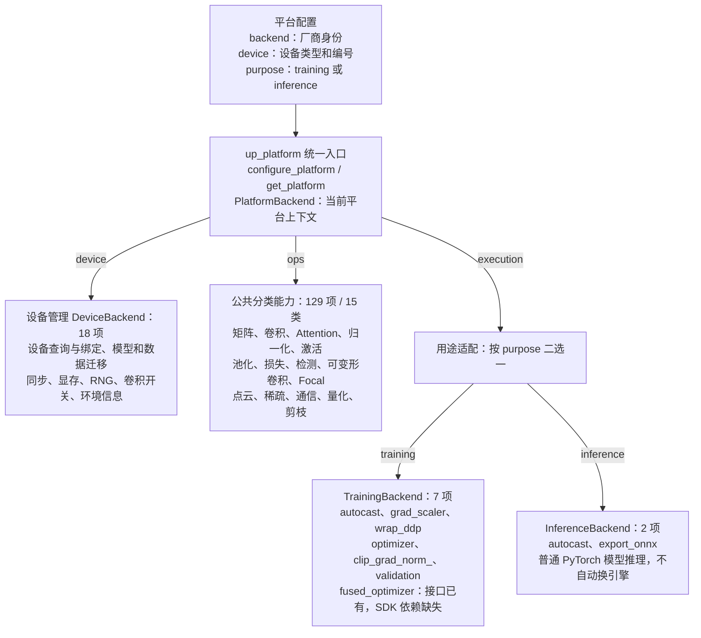
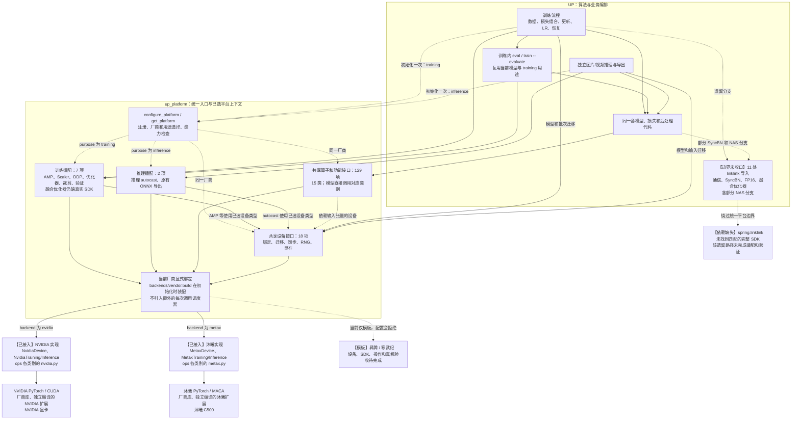
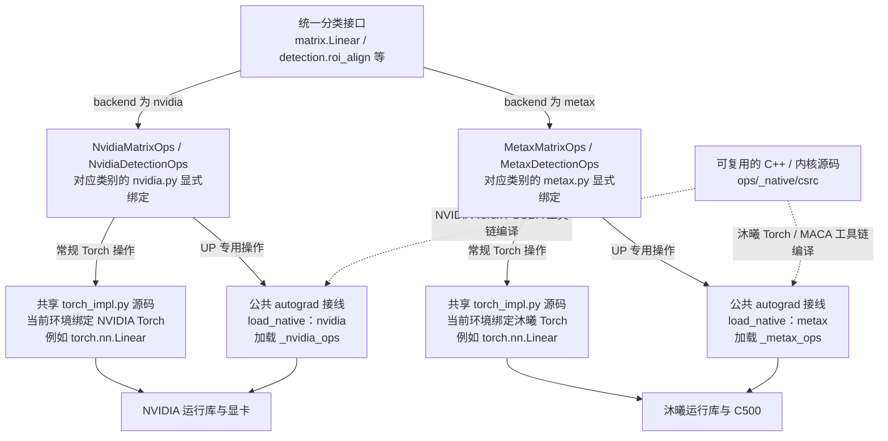

# 平台架构详图：组件归属、调用关系与未完成边界

日期：2026-10-25。依据当前代码与 [156 项接口清单](OPERATION_AUDIT_20261025.md)，本图描述当前实现，不把待完成部分画成已经接入。没有新增训练、修改模型或修复下面的 SDK 缺口。

**训练/推理是执行用途；算子和设备是两种用途共享的能力。平台是包含这些组件、选定一个厂商实现的上下文。**

上一版把四种职责并排写在一层，表达的是组件分类，不能作为严格的调用顺序或上下级关系。需要分开看下面两张图。

## 图一：谁包含谁

实线表示组成关系。`execution` 按入口选择训练或推理实现，进程内不是同时启用两套用途。


原节点关系保留为可编辑参考：

<details>
<summary>查看 Mermaid 节点关系</summary>



</details>

这对应当前对象的真实组成：

```text
PlatformBackend（已选厂商、已选用途）
├── device       DeviceBackend
├── ops          15 类能力对象
└── execution    TrainingBackend 或 InferenceBackend
```

- **设备属于平台内部**：这里的设备是软件接口 `DeviceBackend`，不是物理显卡。厂商身份与设备名称分开；NVIDIA 和沐曦均可使用 `cuda` 名称，身份分别为 `nvidia`、`metax`。
- **算子可以画在训练/推理的下方作为共享依赖**。代码中放在公共 `ops/`，两种用途都引用，不分别复制一套 Linear、卷积和 NMS。
- **训练/推理适配不包含整套业务循环**：数据、配方、损失组合、学习率、优化器步骤和 checkpoint 编排仍由 UP 负责。平台提供 AMP、DDP、优化器构造和执行上下文等接口。

某个厂商如果需要区分训练算子与推理算子，可以在 `build(config, purpose)` 中显式装配不同实现；共享目录不要求所有用途永远采用同一内核。只支持前向的推理内核不能直接作为训练实现，这也不表示当前已经接入新的部署引擎。

## 新厂商怎样实现这些接口


实际需要交付 `device.py`、15 类 `ops/*.py`、`training.py`、`inference.py` 和注册装配。已有厂商 PyTorch 时显式复用兼容方法；缺失操作提供 SDK/内核及所需反向和状态。完全没有 PyTorch 设备后端时，先补张量、派发和 autograd 桥接。

模板生成命令、目录、公共 Torch 绑定、SDK Linear 函数与层的覆盖示例、注册 YAML 和验收要求见[新增厂商实施指南](ADDING_VENDOR.md)。这条接入路径不把下面的 11 处遗留 SDK 分支自动标成已完成。

## 图二：实际调用与缺口

实线表示正常调用或实现绑定；虚线标出配置/设备依赖、模板或绕过平台的遗留分支。下方两家是可选分支，一个进程只装配当前选择的厂商。



“已接入”表示具备实际绑定和已执行路径，不表示 156 项的全部变体都完成验收。缺失依赖、模板、未验证能力分别记录，不能合并成一个“支持/不支持”标签。

模型通过 `get_platform().category(...)` 或层工厂调用算子；训练业务通过 `get_platform().execution` 调用 AMP、DDP 等。**不需要让所有模型算子先经过 `TrainingBackend` 再转发。** 算子通常根据输入 Tensor 的设备执行，也不需要每次都调用 `DeviceBackend` 再选择一次显卡。

训练中的验证使用 `TrainingBackend.validation`：临时切换 eval/no_grad，退出时恢复每个子模块的原模式，平台用途保持 `training`。独立推理在新进程明确选择 `inference`；`.eval()` 本身不会切换厂商或用途。

## 各分类接口里有什么

设备与执行接口完整列出如下。算子表按类别展示职责与代表入口，全部函数名、签名和逐项状态见[完整账本](OPERATION_AUDIT_20261025.md)。

| 组件 | 项数 | 接口内容 |
| --- | ---: | --- |
| 设备识别和绑定 | 7 | `available`、`device`、`set_device`、`device_count`、`current_device`、`properties`、`is_accelerator` |
| 数据迁移和同步 | 2 | `move`、`synchronize` |
| 显存管理 | 4 | `empty_cache`、`memory_allocated`、`max_memory_allocated`、`reset_peak_memory_stats` |
| GPU 随机状态 | 3 | `get_rng_state`、`set_rng_state`、`manual_seed` |
| 设备运行配置 | 2 | `convolution_flags`、`environment` |
| 训练执行 | 7 | `autocast`、`grad_scaler`、`wrap_ddp`、`optimizer`、`clip_grad_norm_`、`validation`、`fused_optimizer` |
| 独立推理与导出 | 2 | `autocast`、`export_onnx` |

算子和功能共 15 类、129 项；这里的“功能”包括通信、量化、剪枝及稀疏张量操作，并非每一项都是数学内核。

| 类别 | 项数 | 内容与代表接口 |
| --- | ---: | --- |
| matrix | 7 | `Linear`、`linear`、`matmul`、`mm`、`bmm`、`addmm`、`einsum` |
| convolution | 4 | `Conv2d`、`ConvTranspose2d` 及对应函数 |
| attention | 1 | `MultiheadAttention` |
| normalization | 10 | BN、LayerNorm、GroupNorm、normalize、Torch SyncBN 及其前向入口 |
| activation | 22 | ReLU/SiLU/GELU 等层和函数、softmax/log_softmax、Dropout |
| pooling | 10 | 最大/平均池化、上采样、interpolate、pad |
| loss | 10 | CE、BCE、KL、L1、CosineSimilarity 等层和函数 |
| detection | 6 | RoIAlign、PSRoIAlign/Pool、NMS、SofterNMS、2D IoU |
| deformable | 1 | `deform_conv`，包含原契约需要的反向 |
| focal | 3 | sigmoid、cross-sigmoid、softmax Focal Loss |
| pointcloud | 10 | 3D/BEV IoU、3D NMS、点入框、点云池化、KITTI 旋转 IoU |
| sparse | 11 | 稀疏张量、SubM/Conv/Inverse、dense、features、原有 CPU voxel 桥接 |
| communication | 17 | 进程组、rank、barrier、广播、聚合、对象通信；当前主路径为 Torch dist |
| quantization | 7 | MQBench 准备、校准、量化、QDrop 重构与原有导出 |
| pruning | 10 | MSBench scheduler、prepare/prune/export、稀疏率、迭代和优化器状态接线 |

## 图三：同一请求怎样落到两家实现

这张图以 Linear 和 UP 专用算子两条路径说明源码复用与二进制隔离。厂商是配置时选择的，图中不表示一次请求执行两家实现。



**沐曦复用的是兼容的代码与接口，不是 NVIDIA 编译出的 GPU 二进制。** 两家的设备名称都为 `cuda`，不参与跨厂商猜测或回退。`MetaxDevice` 会检查沐曦 Torch 身份；误装 NVIDIA wheel 会明确拒绝。

| 实现位置 | NVIDIA 当前做法 | 沐曦当前做法 |
| --- | --- | --- |
| 设备 | `NvidiaDevice` 继承 `TorchDevice`，调用 NVIDIA Torch 的设备 API | `MetaxDevice` 继承同一公共设备实现，调用沐曦 Torch 提供的兼容 API |
| 常规矩阵/卷积/激活等 | 各类别 `nvidia.py` 显式绑定 `torch_impl.py`，执行本环境的 NVIDIA Torch | 各类别 `metax.py` 显式绑定同一公共源码，执行本环境的沐曦 Torch |
| UP 专用操作 | 保留完整操作/autograd 接线，加载 `_nvidia_ops` | 保留相同语义，加载单独编译的 `_metax_ops` |
| 编译和加载 | `UP_BUILD_BACKEND=nvidia`；NVIDIA Torch/CUDA 工具链 | `UP_BUILD_BACKEND=metax`；沐曦 Torch/MACA 工具链；构建和加载均校验厂商 |
| 训练 | `NvidiaTraining` 显式复用 `training/torch_impl.py` | `MetaxTraining` 显式复用同一训练实现，底层由厂商 Torch 提供 |
| 推理 | `NvidiaInference` 复用 `inference/torch_impl.py` | `MetaxInference` 复用同一推理实现；没有借用 NVIDIA 推理引擎 |
| 通信 | 绑定 `torch.distributed`，由本环境通信库执行 | 绑定厂商 Torch 的兼容接口，由其通信栈执行；Torch 后端名相同不等于 GPU 库相同 |
| 稀疏卷积 | NVIDIA spconv；`dense` 走公共绑定 | 沐曦版 spconv；`MetaxSparseOps.dense` 显式把 N…C 转为 NC…，保持 UP 约定 |
| 量化、剪枝 | 共享 MQBench/MSBench 策略接线，依赖固定版本及已记录补丁 | 复用同一策略接线与厂商 Torch；缺失策略明确报错，不更换算法来充数 |

例如 `up_platform.layers.Linear` 返回实际厂商 Torch 模块，不增加一层嵌套 Module 或改变 checkpoint 参数前缀。专用 RoIAlign 的旧 `.apply()` 门面仍保留，内部转向当前厂商绑定和二进制。

源码入口：[平台装配](../../up_platform/factory.py)、[NVIDIA 后端](../../up_platform/backends/nvidia.py)、[沐曦后端](../../up_platform/backends/metax.py)、[公共设备](../../up_platform/backends/torch_device.py)、[训练实现](../../up_platform/training/torch_impl.py)、[推理实现](../../up_platform/inference/torch_impl.py)、[扩展构建](../../up_platform/ops/_native/build.py)、[扩展加载](../../up_platform/ops/_native/loader.py)、[沐曦稀疏布局适配](../../up_platform/ops/sparse/metax.py)。

## 图中未完成部分，以及原因

### 11 处上层 linklink 导入：边界尚未收口

这是 **11 处导入位置**，不是 11 个操作；多处引用相同 SDK 能力。NAS 与 SyncBN/FP16 存在重叠，不能另加一次 NAS 数量。原始机器清单为 [linklink_call_sites.json](linklink_call_sites.json)。

| # | 仍位于 UP 的位置 | 直接使用的能力 | 应收口的责任位置 |
| ---: | --- | --- | --- |
| 1 | `up/models/backbones/mobilenet_v3.py` | `link.nn.SyncBatchNorm2d` | normalization 厂商实现与构造入口 |
| 2 | `up/models/backbones/regnet.py` | `linklink.nn.SyncBatchNorm2d` | normalization 厂商实现与构造入口 |
| 3 | `up/tasks/nas/bignas/controller/utils/misc.py` | NAS 中的 link SyncBN 类型 | normalization 类型/实例识别接口 |
| 4 | `up/tasks/nas/bignas/models/heads/big_roi_head.py` | link SyncBN | normalization 厂商实现 |
| 5 | `up/tasks/nas/bignas/models/ops/dynamic_ops.py` | SyncBN 类、`SyncBNFunc.apply`、var mode | normalization 前向/反向、分组与状态契约 |
| 6 | `up/tasks/nas/bignas/models/search_space/base_bignas_searchspace.py` | link SyncBN 类型 | normalization 类型识别接口 |
| 7 | `up/tasks/nas/bignas/runner/bignas_runner.py` | `fp16.register_float_module` | training 的 FP16 注册接口，需补完整契约 |
| 8 | `up/utils/env/dist_helper.py` | 初始化/结束、group、集合通信、同步/异步 | communication 的 linklink 实现与组/异步对象契约 |
| 9 | `up/utils/general/fp16_helper.py` | FP16 模块注册、初始化 | training 的 FP16 生命周期接口，需补完整契约 |
| 10 | `up/utils/model/bn_helper.py` | SyncBNFunc、SyncBN 类、var mode | normalization 的 linklink 实现 |
| 11 | `up/utils/model/optimizer_helper.py` | 三个融合优化器和 master-weight reload 接线 | training 厂商优化器构造、状态与恢复接线 |

其中 SyncBN 相关 7 处、FP16 相关 2 处、通信 1 处、融合优化器 1 处。`training.fused_optimizer` 虽已有接口和延迟 SDK 加载，旧 optimizer helper 的相应分支仍直接引用 SDK，因此不能把“接口已定义”写成“上层已经迁移”。

当前 normalization 的公共 SyncBN 入口绑定的是 Torch SyncBN，不能把它直接当作 linklink 的 `SyncBNFunc`、var mode 和 group 语义已经实现。

没有完成的原因分两部分：

1. **真实依赖与验收缺口**：UP 原始安装文件没有提供本次所需完整 SDK，两家环境均没有匹配的 `spring.linklink`。公开同名库/接口替代物不具备所需 FP16、SyncBN 和三个融合优化器的完整语义，详见 [SDK 核查](LINKLINK.md)。
2. **边界迁移尚未完成**：此前为保留原语义，将这些旧分支登记为例外，没有替换成普通 Torch 实现；但也没有完成所有调用点迁移。**缺 SDK 不妨碍先定义接口并移动调用边界**，这仍是要完成的工程工作，不能作为继续让 UP 直接引用 SDK 的理由。

收尾应先补齐必要的 FP16、SyncBN/group、异步通信和状态恢复契约，再把这些导入与 SDK 对象接线移入平台后端。没有依赖时由后端明确报错；获得真实 SDK 后做语义与真机验收。当前 156 项是现有契约数，不承诺不增加必要接口。

### 其他状态：与上述边界残留分开

| 项目 | 当前状态 | 原因与边界 |
| --- | --- | --- |
| 普通 Torch 通信、DDP、Torch SyncBN、AMP | 已接入且有双卡执行证据 | 不用于代替 linklink 路径的验收 |
| linklink 融合优化器接口 | 接口/延迟加载已有；缺 SDK；旧分支未全部迁移 | 需要保留原优化器语义和 master-weight 恢复，不能用普通 AdamW 代替 |
| MSBench Amba | 平台入口已隔离，所需 FakeSparse 变体缺依赖 | 2:4 的已执行流程不代表 Amba 通过 |
| 昇腾、寒武纪 | 完整接入模板，后端尚未启用 | 设备/SDK/操作实现和真机验收未交付；选择时明确报模板未支持 |
| 可选 cumm voxel 分支、2:4 permutation、NART/部署引擎 | 已列出能力边界或验收缺口 | 未验证不能改写成未实现，也不能写成已通过 |
| 全部接口的全部 dtype/形状/变体 | 未完成全覆盖验收 | 接口存在、实际接入、执行成功、完整验收是不同状态 |

基础张量存储、autograd、索引、reshape、基础加减由厂商 PyTorch 设备桥接提供。完全没有 PyTorch 后端的厂商还需要补张量存储、派发和 autograd 桥接，不能只填几个算子函数运行 UP。

## 这版图的准确结论

主流程已形成统一平台上下文、共享能力和显式厂商绑定；训练与推理共享算子/设备，保留各自的执行适配。**全仓硬件依赖完全隔离尚未完成，11 处 SDK 残留已在图中明确标注。**

静态边界检查当前报告已纳入规则的调用零违规，同时单列 11 处 SDK 导入缺口。它不是张量类型推断器，也不是所有动态调用均已被证明覆盖的保证。后续迁移必须更新这张图、契约和残留清单，不能只消掉检查告警。
