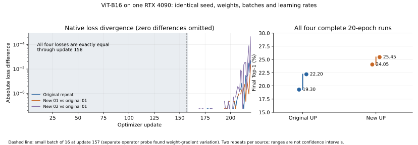

# NVIDIA 同卡 native 波动与平台改造对照

日期：2026-10-24。**状态：8 次完整训练、4 次权重交换推理、指标复算及两阶段算子诊断已完成。**

本轮回答 [三路径精度记录](ACCURACY_NATIVE_20261024.md) 中 YOLO、ViT 的 NVIDIA 原新版差异。
不改模型算法，不放宽 `rtol=1e-4, atol=1e-5`，不恢复旧多随机种子任务。
所有训练仍是 seed 131；同源重复不是更换 seed，也不挑选有利的一次。
冻结要求见 [protocol.json](validation/20261024/native-repeat/protocol.json)。

后续 [原生确定性完整训练对照](NVIDIA_DETERMINISTIC_REPEAT_20261024.md) 已完成：原版、新版同时开启相同选项后，YOLO/ViT 各自四次完整训练的全部 loss、最终模型状态及指标一致；性能代价单列，该阶段不替换本页 native 结果。

## 结论与完整结果

**已确认原版就有非确定性来源，未发现新平台独有的数学或推理偏差。**
YOLO 还包含原版目标构建中的冲突覆盖写入，不应把它全部解释为浮点舍入。
这不等于已证明两套代码的长期精度统计等价：每源只有两次重复，均值差仍如实保留。

| 模型 | 原版01 | 原版02 | 新版01 | 新版02 | 原版同源差 | 新版同源差 |
| --- | ---: | ---: | ---: | ---: | ---: | ---: |
| YOLOv5-S（AP×100） | 24.62 | 26.78 | 19.46 | 25.84 | 2.16 pp | 6.39 pp |
| ViT-B16（Top-1 %） | 19.30 | 22.20 | 24.05 | 25.45 | 2.90 pp | 1.40 pp |

YOLO 两次均值：原版 25.70、新版 22.65，**新 − 原为 −3.05 pp**；ViT 为 20.75、24.75，**新 − 原为 +4.00 pp**。
本轮差异方向与上轮不同物理卡的单次结果相反，不能把单次差值当作固定的重构损失或收益。
这些是两次观测的范围，不是置信区间；没有设置通过线、计算 TOST 或选取最好结果。
精确数值、四种新旧配对差及所有恢复/推理指标见 [summary.json](validation/20261024/native-repeat/summary.json)、[CSV](validation/20261024/native-repeat/results.csv)。

- **8/8** 完成全部预算，共 **14,960** 次更新；数据、初始参数、配方、全部训练批次和完整 LR 轨迹逐项一致。
- **8/8** 最终预测 CPU 指标复算一致，模型参数严格重载；自身恢复/独立推理的全部已报告指标与各自最终 eval 一致。
- **4/4** 最终权重交换推理：原版权重交给新版、新版权重交给原版，两模型的全部任务指标均一致，主指标差为 **0 pp**。这是指标一致，不冒充 logits 逐位比较。
- 完整训练没有观察梯度的钩子或额外算子重放。短程、卷积重放、目标写入重放均是另列阶段，不计入 14,960 次正式更新。
- `up/`、`up_platform/`、`configs/` 均未修改；GPU 始终为同一张 RTX 4090。两个队列插入诊断的父进程均已恢复并正常结束，GPU 锁随控制器退出释放。

## YOLO 前向：原版目标框覆盖写入存在冲突

原版 [监督器](../../up/tasks/det/plugins/yolov5/models/postprocess/roi_supervisor.py) 的目标框写入：

```python
box_gt[bid, aid, grid_j, grid_i, :] = torch.cat((grid_xy - grid_ij, grid_wh), 1)
```

该文件与 UP `52aaeb9e` 相同。不同 GT 可以匹配到同一个 `(batch, anchor, grid_y, grid_x)`，但这里没有定义冲突处理规则。
实际对应原生 `aten.index_put_(..., accumulate=False)`。
PyTorch 对这种“非累加写入且索引重复”的行为未作确定定义，见 [官方接口契约](https://docs.pytorch.org/docs/2.10/generated/torch.Tensor.index_put_.html)。

实际捕获到第二个训练 batch 的 `[56,3,20,20,4]` 目标张量：**1967 次写入、1941 个唯一位置，26 组重复位置全部有不同目标框值**。
原版和新版的完整捕获输入一致；例如同一个位置要写入两个不同的中心偏移和宽高。
该问题会改变监督目标，而不只是低位浮点舍入。

| 独立 PyTorch 重放 | 与第一次不一致 | 超过原容差 | 最大绝对差 |
| --- | ---: | ---: | ---: |
| 原版捕获，native | 8/9 | 8/9 | 1.6806002 |
| 新版捕获，native | 9/9 | 9/9 | 1.6806002 |
| 两套捕获，确定性控制 | 各 0/9 | 各 0/9 | 0 |

每次均从同一目标张量初始状态开始，单独复制可变目标，核验其余参数内容/布局未变；原模型实际写入只执行一次。
独立重放未导入 UP 或平台包。见 [原版](validation/20261024/native-repeat/forward/original)、[新版](validation/20261024/native-repeat/forward/new)、[重复索引检查](validation/20261024/native-repeat/target-duplicates.json)。
该捕获是探针第二批首次观测到的冲突，不宣称已经捕获所有前向差异或证明完整训练首步只有同一来源。

**尚未修复：重复 GT 的取舍策略。** 在平台层随意挑选某个目标或改为最大/平均，会隐性改变训练标签。
本轮遵守不改模型算法的限制，只记录原版问题；确定性重放用于诊断，没有混入 native 训练。

## 原生卷积反向：原版、新版都有权重梯度波动

**原版和新版都存在原生 CUDA 卷积权重梯度波动；脱离 UP 也可复现。**

| 模型 | 本次首次捕获的不稳定调用 | 权重梯度形状 | native 独立重放 | 确定性控制重放 |
| --- | --- | --- | --- | --- |
| YOLOv5-S | 第 1 次 `aten.convolution_backward` | `[3,512,1,1]` | 9/9 次与第一次不逐位相同，最大差约 7.45e−8 | 9/9 次逐位相同 |
| ViT-B16 | 第 157 次 `aten.convolution_backward`，patch embedding | `[768,3,16,16]` | 9/9 次与第一次不逐位相同，最大差约 2.91e−11 | 9/9 次逐位相同 |

每个捕获都运行 10 次，表中 9 次是其余结果分别与第一次比较；不是 9 个训练 seed。
两个模型均对原版、新版各取到一个捕获，四组独立重放的 native/确定性结果一致。
这些局部差异均在既有算子容差内，不能把“不逐位相同”直接称为算子正确性失败。
原始重放记录：[YOLO 原版](validation/20261024/native-repeat/operators/yolo-operators-original)、[YOLO 新版](validation/20261024/native-repeat/operators/yolo-operators-new)、[ViT 原版](validation/20261024/native-repeat/operators/vit-operators-original)、[ViT 新版](validation/20261024/native-repeat/operators/vit-operators-new)。

捕获点的原版、新版参数完全相同：Tensor 的内容哈希、形状、dtype、stride 均一致。
重放进程只加载捕获参数并调用 `torch.ops.aten`，**没有导入 `up` 或 `up_platform`**；每次核验输入没有变化。
因此，这组不稳定性不需要平台路由代码就能出现，不能归为新平台独有的问题。
YOLO 前向还有上述冲突写入，不能把上轮全部 AP/Top-1 差异仅归因于卷积反向。

ViT 配方中 10,000 张训练图、batch64，第一轮第 157 批只有 16 张。
探针在前 156 次卷积反向的两次同参数调用中未捕获差异，第 157 次才捕获。
该次输入为 `[16,3,64,64]`、上游梯度为 `[16,768,4,4]`，与小 batch 对应。
这解释了为什么前 3 步严格测试一致，却仍不足以覆盖后续训练。
这里的“首次”限定于本次探针检查的操作和执行轨迹，不冒充对所有 CUDA 内核的穷尽证明。

四次**未插入探针的完整 ViT 训练**前 158 步 loss 全部逐位相同。
原版重复与原版01/新版01 在第 159 步首次出现 loss 位差，新版重复为第 161 步，均在小 batch 更新之后。
loss 逐位不同不是原算子容差失败；见 [逐步记录](validation/20261024/native-repeat/full-loss-diagnostics.json)。



左图省略零差值，虚线标记第 157 步；右图保留全部四次最终分数，连接线仅表示两次观测范围。
图和独立算子探针属于不同阶段，[图数据校验和](validation/20261024/native-repeat/vit-native-loss.sources.json) 可追溯到完整原始报告。

原生确定性控制是单独的因果诊断：设置 Torch/cuDNN deterministic，并在新进程设置 `CUBLAS_WORKSPACE_CONFIG=:4096:8`。
**完整训练仍关闭这些控制**，没有将更慢的确定性路径混入 native 精度表。
PyTorch 文档明确区分：关闭 benchmark 可以固定算法选择，但算法自身仍可能非确定；其 cuDNN 源码在 deterministic 模式会过滤标记为非确定性的引擎。
见 [PyTorch 2.10 说明](https://docs.pytorch.org/docs/2.10/notes/randomness.html#cuda-convolution-determinism) 和 [Conv_v8.cpp](https://github.com/pytorch/pytorch/blob/v2.10.0/aten/src/ATen/native/cudnn/Conv_v8.cpp#L131-L159)。
本轮尚未记录实际 cuDNN engine 编号，因此不把具体归约/原子内核的猜测写成已测结论。

## 同源短程对照

同一张卡、相同初始参数和三个真实训练 batch；每次均为独立进程。
CPU/GPU RNG 状态及模块 train/eval 状态相同。梯度快照会同步 GPU，故短程观察与完整训练分开记录。

| 对照 | YOLO 第 1/2/3 步超原容差梯度数（共197） | ViT 第 1/2/3 步（共152） |
| --- | --- | --- |
| 原版重复 | 0 / 0 / 56 | 0 / 0 / 0，全部逐位一致 |
| 新版重复 | 0 / 0 / 177 | 0 / 0 / 0，全部逐位一致 |
| 原版01 vs 新版01 | 0 / 189 / 197 | 0 / 0 / 0，全部逐位一致 |

原版 YOLO 本身的原容差失败保留；不为通过测试而放宽。
六组逐步记录见 [梯度对照](validation/20261024/native-repeat/gradients)。
叶子模块类型和配置一致；少量 UP 损失/激活的 forward 源码哈希不同，来自已声明的路由改写，不自动判为错误。
例如 YOLO 的 BCE 路由仍绑定同一个 PyTorch 函数。捕获原语的共同输入检查比单独比较源码哈希更直接。

## 完整同卡协议

- GPU：4090 服务器的物理 1 卡，UUID `GPU-a11f730c-a975-2bf0-b765-3c24d83b7104`；整个任务持有同一个 GPU 文件锁。
- 原版为 UP `52aaeb9e`，新版为 `b137c68` 的运行时，复用上轮不可变 `source-03`；本轮不编辑 `up/`、`up_platform/` 或配方。
- 数据、初始权重、普通依赖、FP32/TF32 设置及 CPU 线程数与上轮相同。Torch `2.10.0+cu126`、TorchVision `0.25.0+cu126`、Python 3.12.3。
- ViT：CIFAR-10 10,000/2,000，64px/batch64，20 epoch，3140 更新；YOLO：PennFudan 120/50，320px/batch64，300 epoch，600 更新。
- 每模型按 `原版01 → 新版01 → 新版02 → 原版02` 串行执行，共 **8 次完整训练、14,960 次更新**。短程和算子诊断的更新不计入此数。
- 保留最终 epoch，不重试、不挑最好值；分别报告两次原版、两次新版、各自范围和所有新旧差。不设精度通过线，不用两次重复声称统计等价。
- 每次保存后严格重载、CPU 指标复算、新进程独立推理。随后把原版01、新版01 的最终权重分别交给另一套运行时推理，分开检查训练轨迹和推理差异。
- GPU 作业不重叠。首个完整训练子任务正常结束后插入算子诊断；只延后队列父进程的下一次启动，未暂停或终止训练/eval 子进程，已自动恢复队列。完整调度收据保留。

本轮补充的 YOLO 前向诊断在最后一次完整训练子任务正常结束后运行，再恢复父队列执行计划内的四次权重交换推理；没有暂停训练子进程。
首次协议之外的这项补充单独保存源码哈希和调度回执，没有替换、删减或重跑主实验。

## 最终证据与限制

[发布审计](validation/20261024/native-repeat/publication-audit.json)、[原始索引](validation/20261024/native-repeat/index.json)、[收集回执](validation/20261024/native-repeat/receipt.json)、[八次摘要](validation/20261024/native-repeat/runs)、[指标与推理审计](validation/20261024/native-repeat/audits) 一起保留。
服务端保存约 26.4 GB 原始文件；回执给出约 8.7 MB 的 `reports.tar.gz` 校验和，包内含报告、预测、标签、配置和命令，不含图片或完整权重。
完整/失败日志、checkpoint、梯度与输入 Tensor 留在原任务目录，不覆盖旧阶段。

本次消除了“数据、初始状态、配置、卡号、输入批次、LR 不同”的已检查因素，确认了两个原版就存在的波动来源。
两个同源重复不足以量化或排除任意小的平台系统偏差，也不代表标准 ImageNet/COCO 收敛、AMP、分布式或所有 NVIDIA 卡均已验证。
YOLO 的未定义目标冲突规则仍需单独处理；没有以提高容差、重选 checkpoint、FP64 模型计算或 CPU 模型代算隐藏差异。
旧多随机种子任务继续暂停。

## 复现入口

服务端目录：`/data2/oujingfeng/up-platform-clean-20261023/native-repeat-20261024`。
共同数据/初始化/两套冻结源码在相邻的 `accuracy-20261024`，具体哈希沿用 [上轮冻结协议](validation/20261024/accuracy/plan.json)。
精确复现需要这些冻结资源；源码公开不等于图片和权重已公开。

```bash
# 只使用已分配的同一张物理卡；本次控制器固定检查上述 GPU1/UUID，不能在另一张卡冒充重现
export OMP_NUM_THREADS=2 MKL_NUM_THREADS=2 PYTHONHASHSEED=0 DEFAULT_TASKS=cls:det
export PYTHONPATH="$DEPS:$MQBENCH:$MSBENCH"
mkdir "$NEW_TASK"
cp tools/trace_native_training.py "$NEW_TASK/"
python tools/run_native_repeat.py --base "$FROZEN_ACCURACY" --output "$NEW_TASK"

# 直接重放已捕获的底层操作；该路径不导入 UP
CUDA_VISIBLE_DEVICES=1 python tools/probe_native_operators.py \
  --capture /path/to/capture-0.pt --output /new/path/native-replay.json

# 确定性对照需要独立进程；不要把此环境混到完整 native 训练中
CUDA_VISIBLE_DEVICES=1 CUBLAS_WORKSPACE_CONFIG=:4096:8 \
  python tools/probe_native_operators.py --capture /path/to/capture-0.pt \
  --deterministic --output /new/path/deterministic-replay.json

# 单独捕获 YOLO 前向目标写入；只在已分配、当前无其他 GPU 作业的卡上运行
CUDA_VISIBLE_DEVICES=1 python tools/probe_yolo_targets.py \
  --source "$FROZEN_ACCURACY/original" --frozen-tools "$FROZEN_ACCURACY/source-03/tools" \
  --data "$FROZEN_ACCURACY/data/data.json" --initial "$FROZEN_ACCURACY/initial/yolov5s/initial.pt" \
  --lane original_nvidia --output /new/path/forward-original

# 收集所有完整报告、CPU 复算和权重交换报告后，缺任一主实验会拒绝生成汇总
python tools/summarize_native_repeat.py --root /collected/native-repeat \
  --output /new/path/summary.json
```

控制器要求新任务目录预先存在，且放入同一版 `trace_native_training.py`；重复 launch 和覆盖输出会拒绝。
公开算子探针的 CPU 测试覆盖“可变目标只更新一次、纯操作不改输入、输入指纹包含布局”。
两套路径合并的 CPU 契约与新增探针测试为 **57 项通过**，见 [XML](validation/20261024/native-repeat/cpu.xml)。一次 pytest 因同时使用符号路径和实际路径，把根目录选到 `/` 而发生权限错误；改用共同实际根目录后通过，失败 XML 没有删除。
